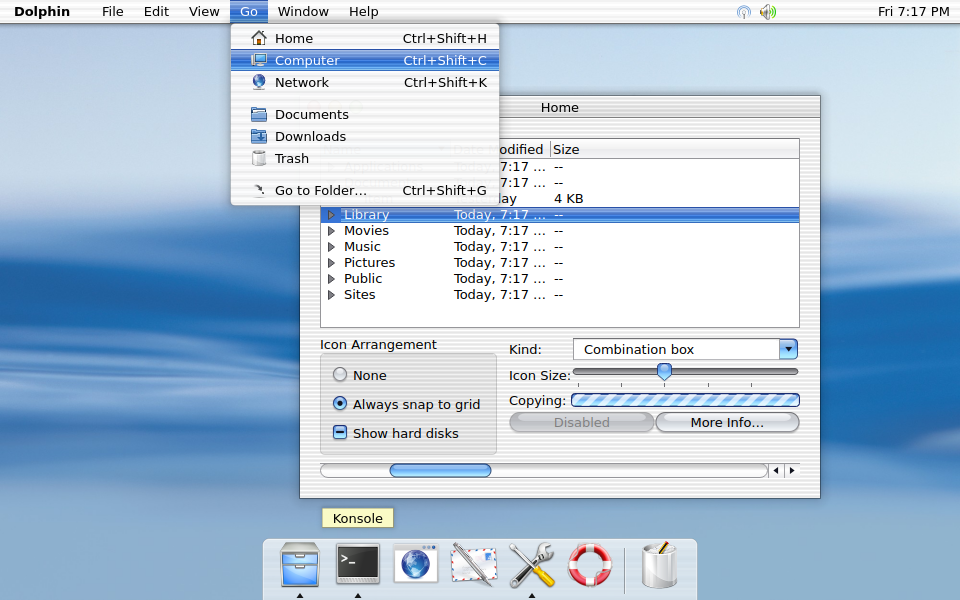
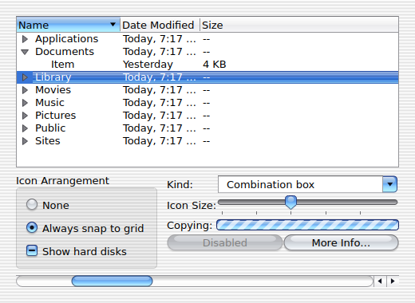

# Pinstripe for KDE Plasma

An Aqua look for Plasma 6, modelled on Mac OS X 10.2 "Jaguar". It has three parts:

* **Pinstripe** and **Pinstripe Graphite**: a Qt 6 widget style (System Settings → Colors & Themes → Application Style)
* **Pinstripe**: a Plasma style (System Settings → Colors & Themes → Plasma Style) with a menu-bar top panel, pinstriped popups, a glass Dock, yellow tooltips and gel buttons
* **Pinstripe** and **Pinstripe Graphite** colour schemes

It pairs with the [Oxygen Traffic Lights](../oxygen-traffic-lights) window decoration.

| Widget style | Plasma style |
|---|---|
|  |  |
|  |  |
| Inactive window:  | Graphite:  |

## How true to 10.2 it is

Sizes come from Apple's *Aqua Human Interface Guidelines* (June 2002), chapter 7:

| Control | HIG | Pinstripe |
|---|---|---|
| Push button | 20 px high, 14 px end caps, 69 px OK/Cancel | same, plus a 2 px shadow |
| Check box / radio button | 18 × 18 incl. shadow | same |
| Pop-up menu | 20 px, text 9 px from the left edge, double-arrow end cap | same, 20 px end cap |
| Tab | 23 px, 12 px text inset, 6 px accent bar, tabs centred | same |
| Text field | 22 px, 3 px inner shadow | same, with the blue focus ring |
| Slider thumb | 15 × 15 round, 15 × 18 pointed when there are ticks | same |
| Window margin / control spacing | 20 px / 12 px | layout margins and spacing |

Colours are sampled pixel by pixel from the HIG's own artwork:

* **Window pinstripe:** repeats every 4 px with rows 255, 238, 230, 238. Menus are lighter: 255, 249, 238, 249.
* **Aqua blue gel:** comes from the 20 px pop-up end cap. A pale lens has a sharp edge at about 45 %, then the colour brightens to cyan at the bottom.
* **Clear gel:** comes from the Cancel button and the unselected tab.
* **Scroll thumb:** comes from a row across the real thumb, with a narrow medium-blue lens on the left and a glow on the right.
* **Selected tab:** flatter and lighter gel, from the "Fonts" tab.

Behaviour follows the HIG too:

* Every push button is clear except the default button, which is coloured and pulses.
* Inactive windows lose their colour: thumbs, pop-up caps, the progress bar and the default button turn clear or grey.
* Dialog buttons use the Mac order, with OK on the right.
* Menus separate groups with blank space, not lines.
* Scroll arrows sit together at the end of the bar.
* Determinate progress bars have moving light bands, and indeterminate ones are a barber pole.

**Deliberate departure from 10.2: the selection highlight.** Jaguar's menu highlight was flat blue. Here it's a glossy gel with the pinstripes showing through, used for menus, the menu bar, selected list rows and Plasma lists.

**Font:** 10.2 used Lucida Grande, which is Apple's and can't be redistributed. If you own a Mac, you can copy it from `/System/Library/Fonts`. The closest freely redistributable font is Luxi Sans by Bigelow & Holmes, Lucida's designers, from X.Org's `font-bh-ttf` package. Set it in System Settings → Fonts. The style itself doesn't force a font.

## Build

```bash
sudo dnf install cmake ninja-build gcc-c++ extra-cmake-modules qt6-qtbase-devel kf6-kcolorscheme-devel kf6-kconfig-devel python3-pyside6
```

```bash
cmake -S . -B build -G Ninja -DCMAKE_BUILD_TYPE=RelWithDebInfo -DCMAKE_INSTALL_PREFIX=$HOME/.local && cmake --build build
```

The Plasma style is generated from `tools/make_plasma_theme.py`. Rerun it after changing colours:

```bash
python3 tools/make_plasma_theme.py
```

## Install

User-local (the Plasma style and colour schemes work straight away from `~/.local/share`):

```bash
cmake --install build
```

The widget style plugin goes to `~/.local/lib64/plugins/styles/`, which Qt doesn't search by default. Either point Qt at it and log in again:

```bash
mkdir -p ~/.config/environment.d && echo 'QT_PLUGIN_PATH=${HOME}/.local/lib64/plugins${QT_PLUGIN_PATH:+:$QT_PLUGIN_PATH}' > ~/.config/environment.d/60-pinstripe.conf
```

or install the plugin system-wide:

```bash
cmake -S . -B build-system -G Ninja -DCMAKE_BUILD_TYPE=RelWithDebInfo -DCMAKE_INSTALL_PREFIX=/usr && cmake --build build-system && sudo cmake --install build-system
```

Then pick them in System Settings, or from a terminal:

```bash
plasma-apply-desktoptheme pinstripe && plasma-apply-colorscheme Pinstripe
```

Try the widget style on one app without changing anything:

```bash
QT_PLUGIN_PATH=$HOME/.local/lib64/plugins dolphin -style Pinstripe
```

## Going back

```bash
plasma-apply-desktoptheme default && plasma-apply-colorscheme BreezeLight
```

Set Application Style back to Breeze or Oxygen in System Settings. To uninstall:

```bash
xargs rm -v < build/install_manifest.txt
```

## Previews without touching the desktop

```bash
cmake -S . -B build -DBUILD_GALLERY=ON && cmake --build build && QT_PLUGIN_PATH=$PWD/build/bin ./build/bin/pinstripe-gallery /tmp/gallery Pinstripe $PWD/colors/Pinstripe.colors
```

```bash
python3 tools/preview_plasma.py /tmp/plasma.png ~/projects/pinstripe/sddm/pinstripe/backgrounds/water.jpg /tmp/gallery/more-active.png
```

## Not done yet

* Tabs on the left, right or bottom, dock widget titles and MDI windows use Fusion's drawing.
* Plasma scroll bars, sliders, progress bars and tab bars fall back to the default Plasma style.
* The Plasma task manager can't draw the Dock's small running-app triangles from an SVG frame. Active apps get a soft glow instead.

## License

GPL-2.0-or-later. Apple's guidelines were used as a measurement reference only; no Apple artwork is included.
