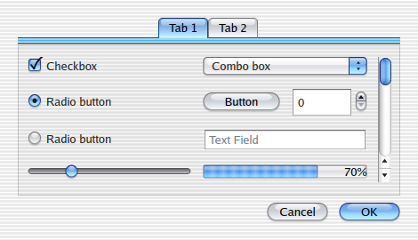
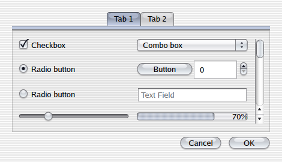
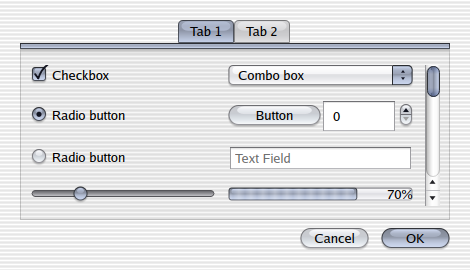
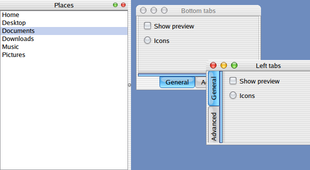
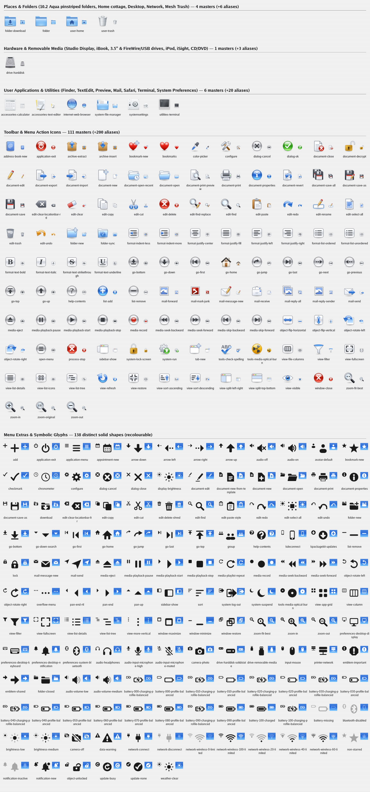

# Pinstripe for KDE Plasma

An Aqua look for Plasma 6, modelled on Mac OS X 10.2 "Jaguar". It has four parts:

* **Pinstripe** and **Pinstripe Graphite**: a Qt 6 widget style (System Settings → Colors & Themes → Application Style)
* **Pinstripe**: a Plasma style (System Settings → Colors & Themes → Plasma Style). It has a menu-bar top panel, pinstriped popups, a glass Dock with running-app triangles, yellow tooltips, gel buttons, scroll bars, sliders, progress bars and tabs.
* **Pinstripe**: a GTK 3 and GTK 4 theme, so GTK apps match
* **Oxygen Pinstripe**: an icon theme that provides Mac OS X 10.2 Aqua full-colour action icons and solid menu-extra symbolic glyphs on top of Oxygen
* **Pinstripe** and **Pinstripe Graphite** colour schemes

It pairs with the [Oxygen Traffic Lights](https://github.com/jun0p3r/oxygen-traffic-lights) window decoration.

| Widget style | Plasma style |
|---|---|
|  |  |
|  |  |
| Inactive window:  | Graphite:  |
| Dock widget, MDI windows, bottom and left tabs:  | |
| GTK 3:  | GTK 4:  |

## Oxygen Pinstripe icons



Oxygen Pinstripe adds two Mac OS X 10.2 "Jaguar" layers on top of Oxygen:

* **Full-colour 10.2 Aqua action icons** (111 master artworks + 200 freedesktop/GTK aliases at
  16, 22, 24, 32, `32@2x` and 48 px in `Context=Actions`), sampled from Apple's 2002 HIG
  Chapter 11 (Figures 11-18, 11-19 and dialog figures): round clear-glass navigation buttons
  (`Back` / `Forward` with crisp black triangle + twin dots, `Up`, `Down`, `?` Help), sky-blue
  pinstriped Aqua folders with navy-outlined `+` badges (`New Folder`, `Open`), curled white
  document sheets, 3.5" floppy disk, front-on desktop printer, Sherlock silver-rimmed glass
  magnifier and zoom lenses, yellow wooden `Compose` pencil, perforated blue and crimson Mail
  postage stamps, spiral-bound `@` address book, Finder `Home` cottage, glossy ruby `Favorites`
  heart, crossed `Utilities` hammer & wrench, `Disc Burner` trefoil, `Preview` rotate cards,
  sliding-drawer `Sidebar`, and formatting palette tiles.
* **Solid, rounded symbolic & menu-extra glyphs** (426 names, 139 distinct shapes) modelled on
  the 10.2 menu extras — the AirPort fan, the speaker with waves, the horizontal battery, the
  eject key, and solid triangle arrows — instead of thin wireframe line art.
* It inherits Oxygen (then Breeze and hicolor) for application, place, device and mimetype icons.
* The tray names are also provided at panel sizes (16 to 24 px), so the Plasma system tray
  shows the menu extras instead of Oxygen's colour tray icons: volume, network, battery
  (including power profiles), Bluetooth, brightness, notifications, updates, microphone,
  camera, clipboard, KDE Connect and media.
* Symbolic glyphs are filled shapes only, with no strokes, using KDE's `ColorScheme-Text` class
  and `fill:currentColor`, so KDE and GTK recolour them. Unused signal bars and quiet
  volume waves are the same colour at 35 % opacity.

Generated by `tools/make_icons.py` (contact sheet: `tools/preview_icons.py`). Pick it in
System Settings → Colors & Themes → Icons → Oxygen Pinstripe.

## How true to 10.2 it is

Sizes come from Apple's *Aqua Human Interface Guidelines* (June 2002), chapter 7:

| Control | HIG | Pinstripe |
|---|---|---|
| Push button | 20 px high, 14 px end caps, 69 px OK/Cancel | same, plus a 2 px shadow |
| Check box / radio button | 18 × 18 incl. shadow | same |
| Pop-up menu | 20 px, text 9 px from the left edge, double-arrow end cap | same, 20 px end cap |
| Tab | 23 px, 12 px text inset, 6 px accent bar, tabs centred | same |
| Text field | 22 px, 3 px inner shadow | same, with the blue focus ring |
| Slider thumb | 15 × 15 round, 15 × 18 pointed when there are ticks | same |
| Window margin / control spacing | 20 px / 12 px | layout margins and spacing |

Colours are sampled pixel by pixel from the HIG's own artwork:

* **Window pinstripe:** repeats every 4 px with rows 255, 238, 230, 238. Menus are lighter: 255, 249, 238, 249.
* **Aqua blue gel:** comes from the 20 px pop-up end cap. A pale lens has a sharp edge at about 45 %, then the colour brightens to cyan at the bottom.
* **Clear gel:** comes from the Cancel button and the unselected tab.
* **Scroll thumb:** comes from a row across the real thumb, with a narrow medium-blue lens on the left and a glow on the right.
* **Selected tab:** flatter and lighter gel, from the "Fonts" tab.

Behaviour follows the HIG too:

* Every push button is clear except the default button, which is coloured and pulses.
* Inactive windows lose their colour: thumbs, pop-up caps, the progress bar and the default button turn clear or grey.
* Dialog buttons use the Mac order, with OK on the right.
* Menus separate groups with blank space, not lines.
* Scroll bars: the whole bar is an opaque white cylinder, and the track has rounded, shaded ends. The thumb sits 1 px inside the track with a crisp navy rim; its columns are measured pixel by pixel from the real thumb, including the sharp dip after the lens. The arrows sit together at the end of the bar.
* Determinate progress bars have moving light bands, and indeterminate ones are a barber pole.

**Deliberate departure from 10.2: the selection highlight.** Jaguar's menu highlight was flat blue. Here it's a glossy gel with the pinstripes showing through, used for menus, the menu bar, selected list rows and Plasma lists. The highlight on top (11 px) and the glow at the bottom (8 px) have fixed heights, and only the striped middle grows, so a tall launcher tile and a menu row look the same in Qt, GTK and Plasma.

**Font:** 10.2 used Lucida Grande, which is Apple's and can't be redistributed. If you own a Mac, you can copy it from `/System/Library/Fonts`. The closest freely redistributable font is **Luxi Sans** by Bigelow & Holmes, Lucida's designers, from X.Org's `font-bh-ttf` package. The previews use it. The GTK theme asks for Lucida Grande, then Luxi Sans. For Qt and Plasma apps, set it in System Settings → Text & Fonts. To install Luxi for your user:

```bash
mkdir -p ~/.local/share/fonts/luxi && curl -sSfL https://www.x.org/releases/individual/font/font-bh-ttf-1.0.4.tar.xz | tar -xJ --strip-components=1 -C ~/.local/share/fonts/luxi --wildcards '*.ttf' '*/COPYING' && fc-cache -f
```

## Switch everything at once

After installing (below), one script switches the colour scheme, Plasma style, icons, widget
style, GTK theme, Luxi Sans and the Oxygen Traffic Lights decoration. Your current settings
are saved first, so the revert script puts back exactly what you had.

```bash
contrib/apply-pinstripe.sh
```

`--graphite` picks the Graphite variants, `--no-font` leaves your fonts alone and
`--mac-buttons` puts close, minimize and maximize on the left of the title bar. To go back:

```bash
contrib/revert-pinstripe.sh
```

## Build

```bash
sudo dnf install cmake ninja-build gcc-c++ extra-cmake-modules qt6-qtbase-devel kf6-kcolorscheme-devel kf6-kconfig-devel python3-pyside6
```

```bash
cmake -S . -B build -G Ninja -DCMAKE_BUILD_TYPE=RelWithDebInfo -DCMAKE_INSTALL_PREFIX=$HOME/.local && cmake --build build
```

The Plasma style and the GTK theme are generated. Rerun the generators after changing colours:

```bash
python3 tools/make_plasma_theme.py && python3 tools/make_gtk_theme.py && python3 tools/make_icons.py
```

## Install

User-local (the Plasma style and colour schemes work straight away from `~/.local/share`):

```bash
cmake --install build
```

The widget style plugin goes to `~/.local/lib64/plugins/styles/`, which Qt doesn't search by default. Either point Qt at it and log in again:

```bash
mkdir -p ~/.config/environment.d && echo 'QT_PLUGIN_PATH=${HOME}/.local/lib64/plugins${QT_PLUGIN_PATH:+:$QT_PLUGIN_PATH}' > ~/.config/environment.d/60-pinstripe.conf
```

or install the plugin system-wide:

```bash
cmake -S . -B build-system -G Ninja -DCMAKE_BUILD_TYPE=RelWithDebInfo -DCMAKE_INSTALL_PREFIX=/usr && cmake --build build-system && sudo cmake --install build-system
```

`cmake --install build` also puts the GTK theme in `~/.local/share/themes/Pinstripe` and the icon theme in `~/.local/share/icons/Oxygen-Pinstripe`. Pick it in System Settings → Colors & Themes → Application Style → Configure GNOME/GTK Application Style. GTK windows with client-side title bars get the traffic lights. Put them on the left with:

```bash
gsettings set org.gnome.desktop.wm.preferences button-layout "close,minimize,maximize:"
```

Then pick the rest in System Settings, or from a terminal:

```bash
plasma-apply-desktoptheme pinstripe && plasma-apply-colorscheme Pinstripe
```

Try the widget style on one app without changing anything:

```bash
QT_PLUGIN_PATH=$HOME/.local/lib64/plugins dolphin -style Pinstripe
```

## Going back

```bash
plasma-apply-desktoptheme default && plasma-apply-colorscheme BreezeLight
```

Set Application Style back to Breeze or Oxygen in System Settings. To uninstall:

```bash
xargs rm -v < build/install_manifest.txt
```

## Previews without touching the desktop

```bash
cmake -S . -B build -DBUILD_GALLERY=ON && cmake --build build && QT_PLUGIN_PATH=$PWD/build/bin ./build/bin/pinstripe-gallery /tmp/gallery Pinstripe $PWD/colors/Pinstripe.colors
```

```bash
python3 tools/preview_plasma.py /tmp/plasma.png path/to/wallpaper.jpg /tmp/gallery/more-active.png
```

GTK, rendered through a headless Broadway display:

```bash
broadwayd :7 & GDK_BACKEND=broadway BROADWAY_DISPLAY=:7 python3 tools/gtk_gallery.py 3 /tmp/gtk3.png
```

```bash
gtk4-broadwayd :8 & GDK_BACKEND=broadway BROADWAY_DISPLAY=:8 python3 tools/gtk_gallery.py 4 /tmp/gtk4.png
```

## Limits

* **QML apps** (System Settings, Discover and other Kirigami apps) paint their page
  backgrounds as flat colours from the palette, so they can't show the pinstripes. Their
  controls still use the widget style. Every Qt Widgets app (Dolphin, Kate, Konsole and so on)
  gets the stripes.
* **Dock triangles:** a Plasma frame can't centre a single shape. The triangle sits in a stretched bottom edge between wide, transparent corners. It's sized for the default 44 px panel; on thicker panels it gets wider.
* **GTK tabs** can't be centred, because GTK's CSS has no `margin: auto`. They stay left-aligned over the blue accent bar.
* **libadwaita apps** (most GNOME apps) ignore GTK themes; only plain GTK 3 and GTK 4 apps pick up Pinstripe.

## License

GPL-2.0-or-later. Apple's guidelines were used as a measurement reference only; no Apple artwork is included.
